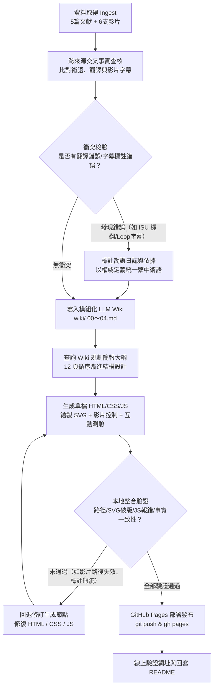

# 《花式滑冰六大跳躍動作入門指南》教學型 HTML 簡報專案

> **專案目標**：以 LLM Wiki 作為唯一定案知識來源（Single Source of Truth），製作兼具手繪插畫美學與互動教學功能的單檔 HTML 簡報，專為花式滑冰零基礎新手設計，並透過 GitHub Pages 公開發布。

- **線上簡報展示網址**：[https://alpacamymac.github.io/figure-skating-jumps-wiki/](https://alpacamymac.github.io/figure-skating-jumps-wiki/)
- **GitHub 專案倉庫**：[https://github.com/Alpacamymac/figure-skating-jumps-wiki](https://github.com/Alpacamymac/figure-skating-jumps-wiki)

---

## 一、專案特色與亮點

1. **零外部依賴單檔架構**：整份簡報 `index.html` 內嵌所有 CSS 樣式、JavaScript 互動邏輯與向量插畫 SVG，無需任何打包工具或外部套件即可隨處開啟。
2. **柔和冰藍手繪插畫風格**：專門為新手打造的視覺體驗，採用冰藍（Ice Blue）、奶油白卡片與溫潤圓角手繪風格，擺脫傳統教材的枯燥感。
3. **高品質影片慢動作解析**：直接整合 6 支羽生結弦示範之循環跳躍影片，並配備「暫停／播放」與「0.5x 慢速播放」功能，讓新手清楚觀察冰刀壓刃與點冰瞬間。
4. **內嵌 7 組手繪風 SVG 幾何圖解**：包含冰刀中凹截面（Hollow）、內外刃傾斜剖面、點冰槓桿 vs 刀刃蓄力彈起、Salchow（內八平行）vs Loop（X 交叉垂直）俯視站姿圖、Lutz 反 S 進入軌跡與 Axel 540° 轉體盤。
5. **現學現賣互動測驗**：內建 3 題實戰互動情境測驗，點選後提供即時回饋、詳細觀念解析與成績統計。

---

## 二、LLM Wiki 結構與知識來源

本專案嚴格貫徹「Wiki-First」原則，簡報產出前先將所有多模態資料消化、查核並模組化存儲於 `wiki/` 目錄：

```text
wiki/
├── 00-index-and-verification.md   # Wiki 總目錄、資料來源清單與「跨來源查核日誌」
├── 01-fundamentals.md             # 冰刀幾何（刀齒、內外刃、Hollow）、順逆時針、三步驟判別法
├── 02-six-jumps.md                # 六大跳躍深度拆解（由易到難：T→S→Lo→F→Lz→A、歷史、視覺特徵、錯刃）
├── 03-scoring-and-rules.md        # 競賽計分機制（周數角度計算、ISU 基礎分表、GOE 評分、小分表符號 q/<e/!）
└── 04-combos-and-glossary.md      # 連跳技術（Combo vs Sequence、Euler）、雙人拋跳、Tano/Rippon、中英速查表
```

### 參考資料來源（共 5 篇專業文獻 + 6 支教學影片）
1. **維基百科（中文版）**：《花樣滑冰的跳躍動作》（提供 ISU 2022-2023 新規分值與 GOE 規程）。
2. **台灣滑冰指南**：《花式滑冰的六種跳躍（動作表）》（提供初學者三步驟判別法與動作難度分級）。
3. **ISU 官方跳躍中文解析**（`raw_sources/isu-jumps.pdf`，國際滑冰總會圖解教材）。
4. **Dcard 運動板貼文**（`raw_sources/dcard-jumps.pdf`，《#花式滑冰 六種跳躍分辨動圖》）。
5. **Bilibili 圖文小教室**（`raw_sources/bilibili-et-jumps.pdf`，《【多圖】【花滑小知識】如何區分六種跳躍》）。
6. **羽生結弦示範教學影片**（位於 `videos/`，包含 `toe-loop.mp4`、`salchow.mp4`、`loop.mp4`、`flip.mp4`、`lutz.mp4`、`axel.mp4`）。

---

## 三、Loop / Graph 工作流設計（工作流程與架構圖）

為了避免傳統 LLM 生成簡報時常發生的「幻覺累積（Hallucination Compounding）」與「格式錯誤」，本專案採用**雙層反饋循環圖（Dual-Loop Graph）**工作流架構：



### 重複執行與退回檢查機制說明：
1. **Loop 1（資料層查核退回）**：
   - 在原始資料寫入 Wiki 之前，必須進行**跨來源橫向對比**。如果直接將簡體機翻（如 ISU PDF 把 Toe Loop 寫成「勾手跳」）寫入 Wiki，後續所有的簡報與題目都會全盤皆錯。因此在此節點設立攔截門檻，必須將錯誤修正並記入勘誤日誌後，才允許生成 Wiki。
2. **Loop 2（展示層技術退回）**：
   - 簡報生成後，自動化腳本會對 `index.html` 的 6 支影片相對路徑、7 組內嵌 SVG 語法、12 頁 slide 容器 ID 以及 JavaScript 測驗狀態機進行本地檢驗。若有任何語法錯誤或路徑不存在，立即退回修訂，確保上線版本 100% 正常運作。

---

## 四、執行反思與架構演進

在本次專案實作過程中，我們進行了深刻的執行反思，特別針對「出錯熱點」與「工作流程優化」進行了調整：

### 1. 哪一個節點最常出錯？
在實際執行中，**「原始資料的翻譯衝突」與「第三方影音的標註錯誤」**是最容易讓 AI 系統踩坑的盲點：
- **ISU 簡中機翻的致命錯誤**：官方 PDF 標題明明是後外點冰跳（Toe Loop），內文第一句卻翻譯成「勾手跳」（Lutz），且把 Flip 譯為「翻轉」、Loop 譯為「循環」。若 LLM 只是單純做文字摘要，就會把錯誤直接搬移到簡報中，嚴重誤導初學者。
- **教學動圖字幕的左右腳混淆**：在 `loop.mp4` 慢動作示範中，原製作者打上了字幕 `LEFT FOOT SWITCHES TO OUTSIDE EDGE`。但羽生結弦是逆時針選手，後外結環跳（Loop）真正受力起跳並落冰的腳是**右腳**（左腳只是交叉在前導向）。

### 2. 發現問題後，把檢查節點往前移到了哪裡？
- 原本直覺的工作流可能是「讀取資料 $\rightarrow$ 直接寫 Wiki $\rightarrow$ 產出簡報 $\rightarrow$ 最後再檢查」。
- 發現上述問題後，我們**將事實查核節點大幅前移至「寫入 Wiki 之前（Pre-Wiki Ingestion Check）」**。
- 確立了「**先查核比對、統一術語字典、標記勘誤日誌，再撰寫 Wiki**」的鐵則。Wiki 一旦定案，後續所有 HTML 與測驗便能高枕無憂地完全信任 Wiki。

### 3. 如何修改了原本的 workflow / graph，以及原因？
- **演進前**：`Data Ingest -> Write Wiki -> Generate HTML -> Final Check`（單向線性流）。
- **演進後**：改為上方 Mermaid 所示的 **雙層反饋工作流（Dual-Loop Graph）**。
  - **前移理由**：在資料層攔截錯誤的成本是 $O(1)$，但在 HTML 生成後甚至部署後才發現基礎動作名稱錯亂，修改成本是 $O(N)$（牽涉 Wiki 5 個檔案、HTML 12 頁文案與互動測驗）。
  - **增設可視化輔助**：為了解決靜態文字對新手不夠直觀的問題，我們在簡報生成階段強制加入「**手繪風俯視站姿圖（SVG）**」與「**0.5x 慢速播放按鈕**」，將抽象的滑冰幾何轉化為一目了然的直覺圖解。

---

## 五、本機測試與部署步驟

若要在本機檢視或重現專案：

```bash
# 1. 複製專案
git clone https://github.com/Alpacamymac/figure-skating-jumps-wiki.git
cd figure-skating-jumps-wiki

# 2. 本地快速預覽
python3 -m http.server 8000
# 瀏覽器開啟 http://localhost:8000
```
