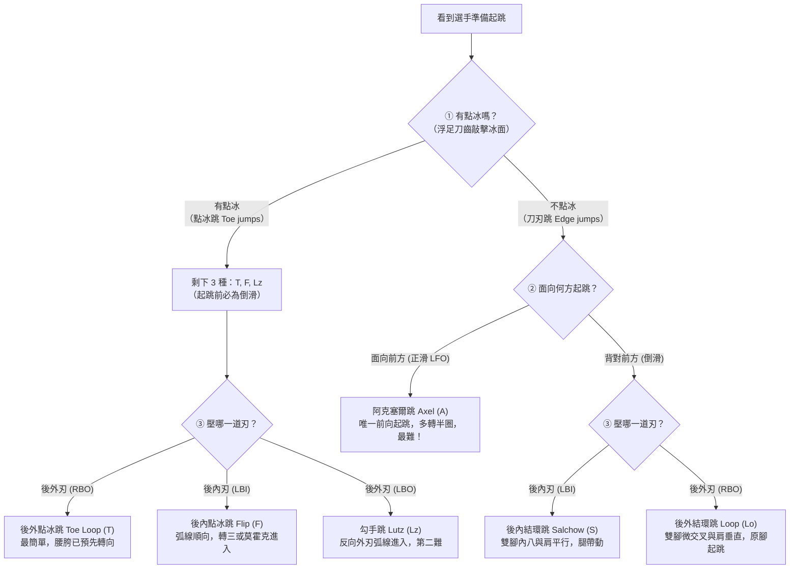

# 花式滑冰基礎物理與冰刀幾何

要看懂花式滑冰的六大跳躍，不需要先成為力學專家，只需要建立正確的「冰刀幾何」觀念與「三步驟判別邏輯」。

---

## 一、冰刀解剖學：刀齒與刀刃的奧秘

花式滑冰鞋的冰刀（Figure Skate Blade）並不是一把平整的菜刀，而是由特殊鋼材打造、具有精密弧度的運動器材：

```text
[ 前端：刀齒 (Toe Pick) ] ─── [ 中段：刀刃 (Blade Edges) ] ─── [ 後端：刀尾 (Tail) ]
```

1. **刀齒（Toe Pick）**：
   - 位於冰刀前端最下方的鋸齒狀結構。
   - 主要功能：在「點冰跳（Toe jumps）」起跳瞬間點入冰面，如同撐竿跳中的撐竿一樣提供垂直起跳的制動與槓桿爆發力；也用於旋轉（Spin）的起轉、特定步法與煞車。
2. **中空圓弧刀底（Hollow）與雙刃構造**：
   - 冰刀底部中央磨有一道縱向的內凹圓弧形溝槽（稱為 Hollow）。
   - 這個溝槽將冰刀的接地接觸面一分為二，形成了兩道極其鋒利的平行刀刃：
     - **內刃（Inside Edge）**：靠近人體正中線（大拇趾側）的刀刃。
     - **外刃（Outside Edge）**：遠離人體正中線（小趾側、腳外側）的刀刃。
   - 選手滑行時，透過腳踝與身體傾斜（Lean），只能壓在內刃或外刃上，在冰面上刻出優美的圓弧線；平刃（Flat）滑行在比賽評分中通常會被視為欠缺刃度深度（Edge depth）。

---

## 二、人體旋轉慣用方向：順時針 vs. 逆時針

如同人類有慣用右手與慣用左手之分，花式滑冰選手也有旋轉方向的慣性：

| 旋轉方向 | 比例 | 特色與標準動作基準（本指南基準） |
| :--- | :--- | :--- |
| **逆時針旋轉（Counter-clockwise）** | **約 85%～90%** | **本指南的預設標準**。選手向左側旋轉，**所有六種跳躍一律落在「右腳後外刃（RBO）」**。 |
| **順時針旋轉（Clockwise）** | 約 10%～15% | 俗稱「反方向選手」（如名將 Johnny Weir、Carolina Kostner）。所有左右腳動作剛好與逆時針選手鏡像對稱，落冰於「左腳後外刃（LBO）」。 |

> **初學者黃金法則**：
> 對於絕大多數選手（逆時針），只要記住：**「起跳方式有六種，但落冰只有一種——右腳後外刃（Right Back Outside, RBO）！」**

---

## 三、新手 30 秒看懂跳躍：「三步驟判別法」

在瞬息萬變的電視轉播中，新手往往眼花撩亂。台灣滑冰指南提煉出非常高效率的「三步驟判斷法」：



### 步驟詳解：
1. **第一步（最直觀）：看浮足有沒有點冰？**
   - 有用另一腳刀齒扎冰借力 $\rightarrow$ **點冰跳（Toe jumps）**：Toe Loop、Flip、Lutz。
   - 沒有點冰，雙腳單純靠滑行刃彈起 $\rightarrow$ **刀刃跳（Edge jumps）**：Salchow、Loop、Axel。
2. **第二步（秒殺 Axel）：看起跳滑行是正滑還是倒滑？**
   - **面向前方起跳** $\rightarrow$ 百分之百是 **Axel（阿克塞爾跳）**！它是六種跳躍中唯一的特例。
   - **背對前方（倒滑）起跳** $\rightarrow$ 其餘五種都是倒滑起跳。
3. **第三步（看慢動作細節）：看支撐腳壓的是內刃還是外刃？**
   - 身體向內傾斜（向支撐腳內側倒） $\rightarrow$ **內刃（Inside）**：Salchow（刀刃）、Flip（點冰）。
   - 身體向外傾斜（向支撐腳外側倒） $\rightarrow$ **外刃（Outside）**：Loop（刀刃）、Lutz（點冰）、Toe Loop（點冰）。

---

## 四、為什麼強烈建議新手同時記憶「英文名與縮寫」？

在中文語境下，跳躍的中文翻譯長期存在極為混淆的問題：
1. **中文名稱冗長且極易口誤**：
   - 「後外結環跳（Loop）」與「後內結環跳（Salchow）」只差一個字，口語播報或學習時非常容易混淆。
   - 「後外點冰跳（Toe Loop）」與「後內點冰跳（Flip）」同樣只差一個字，但難度相差懸殊。
2. **國際賽事與轉播即時小分表全面採用英文字母縮寫**：
   - 轉播畫面上左上角的技術動作框（Tech Box）永遠只顯示：`3A`、`4T`、`4Lz`、`3F` 等，絕不會出現中文字幕。
   - 記住 **T（Toe Loop）、S（Salchow）、Lo（Loop）、F（Flip）、Lz（Lutz）、A（Axel）** 這 6 個字母，能讓你在看比賽的 0.1 秒內直接連動理解周數與動作類型！
